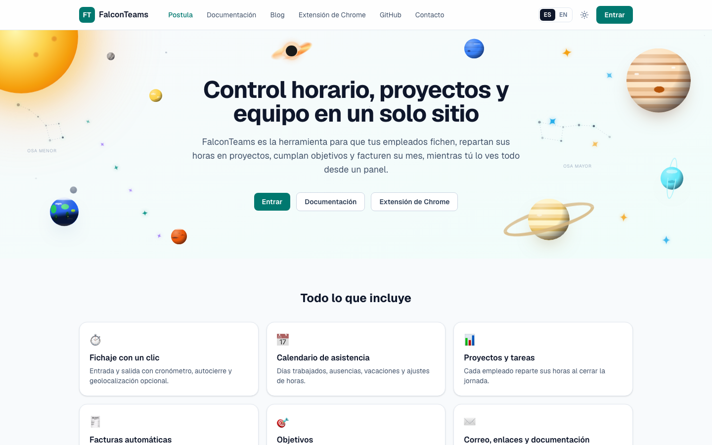
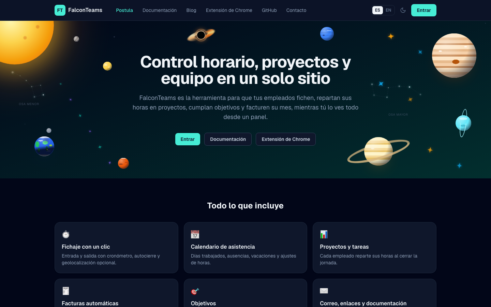
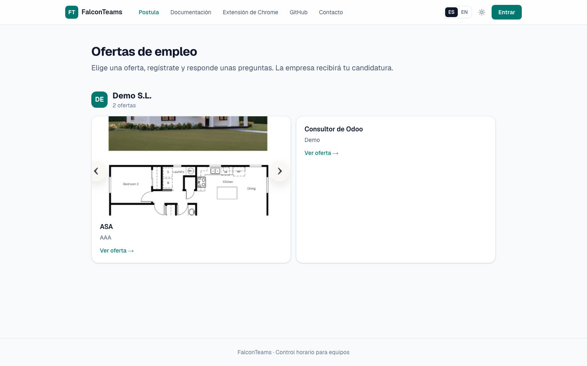
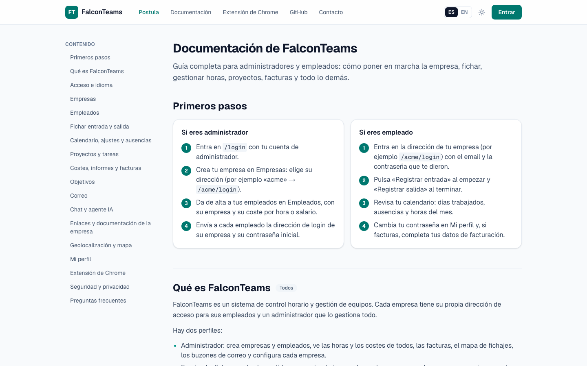
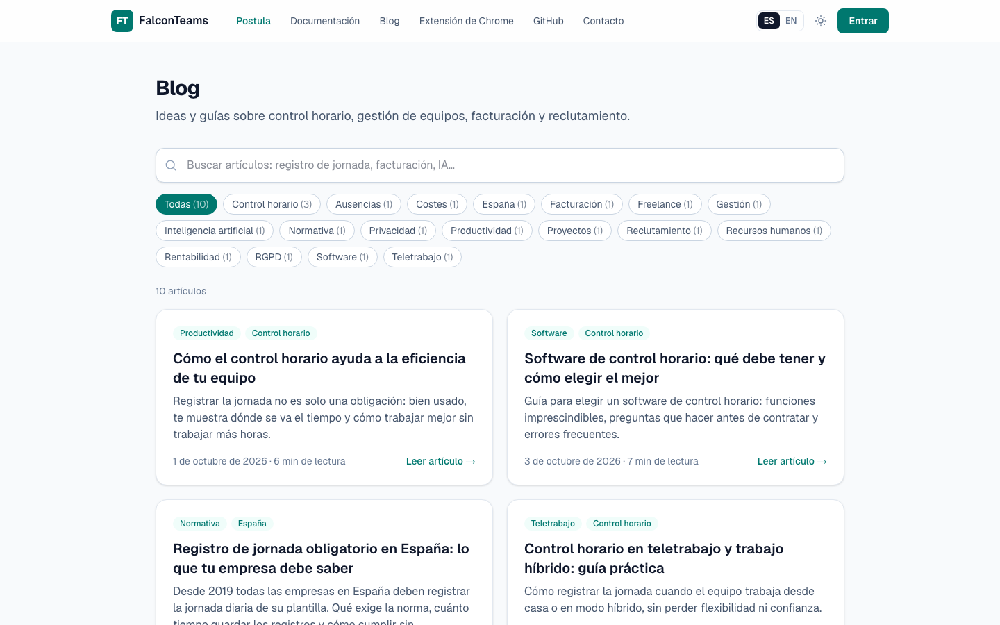
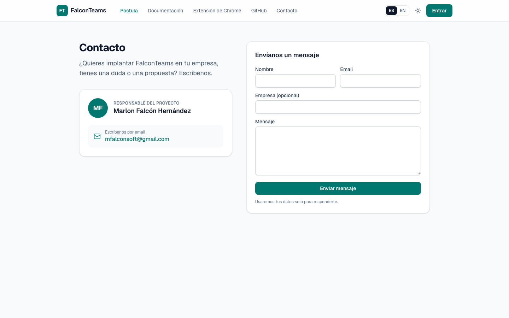

# falconteams.xyz

Control horario de empleados con Next.js 16 y [falcondatabase](https://falcondatabase.com).

## Capturas

| Landing (modo claro) | Landing (modo oscuro) |
| --- | --- |
|  |  |

| Ofertas de empleo («Postula») | Documentación |
| --- | --- |
|  |  |

| Blog | Contacto |
| --- | --- |
|  |  |

## Funcionalidades

- **Landing** (`/`) en español e inglés, con la guía de la extensión de Chrome.
- **Login** con usuarios de falcondatabase y sesión en una cookie httpOnly.
- **Admin** (`/admin`): dashboard, empresas (autocierre), empleados (empresa, coste por hora o salario mensual,
  geolocalización, objetivos), facturas de todos, mapa de fichajes, buzones de correo y sus propias horas.
- **Empresa** (`/<empresa>`): fichaje con cronómetro, notas y reparto de horas en proyectos; calendario de asistencia
  (ajuste de horas por día, ausencias: vacaciones, enfermedad, permisos); factura del mes que se acumula sola;
  objetivos con evidencia (documento o YouTube); correo IMAP/SMTP; chat con compañeros, admins y agente IA (OpenAI);
  proyectos y tareas; enlaces con credenciales cifradas; documentación en carpetas; perfil (foto y contraseña).
- **Extensión de Chrome** (`extension/`, se descarga desde la landing): fichar sin abrir la app.
- Modo claro/oscuro y menú lateral.

## Puesta en marcha

FalconTeams usa [falcondatabase](https://falcondatabase.com) como base de datos (PostgreSQL), login de usuarios y API.
Necesitas Node.js 20+ y un proyecto en falcondatabase.

```bash
git clone https://github.com/falconsoft3d/falconteams.xyz.git
cd falconteams.xyz
npm install
cp .env.example .env.local      # rellena FDB_PROJECT, FDB_AI_TOKEN y APP_SECRET

# Crea todas las tablas (falcondatabase/schema.json), activa el login y crea el primer admin.
# Es idempotente: se puede repetir tras actualizar el código para añadir tablas o columnas nuevas.
ADMIN_EMAIL=admin@tuempresa.com ADMIN_PASSWORD='una-clave-segura' npm run setup
# Copia en FDB_ANON_KEY la clave anon que muestra el script.

npm run dev                      # http://localhost:3000
```

| Variable | Descripción |
| --- | --- |
| `FDB_URL` | `https://falcondatabase.com` |
| `FDB_PROJECT` | Ref del proyecto en falcondatabase |
| `FDB_ANON_KEY` | Clave anon (solo se usa para el login) |
| `FDB_AI_TOKEN` | Token de servidor: lee y escribe las tablas privadas. Nunca llega al navegador |
| `APP_TIMEZONE` | Zona horaria para calcular los días (por defecto `Europe/Madrid`) |
| `CRON_SECRET` | Opcional: protege `/api/cron/auto-close` |
| `APP_SECRET` | Clave para cifrar contraseñas (enlaces, correo, token de OpenAI). No la pierdas |
| `NEXT_PUBLIC_CURRENCY` | Moneda de costes y facturas (por defecto `EUR`) |
| `OPENAI_BASE_URL` | Opcional: API compatible con OpenAI para el agente IA y el reclutamiento |

Tras cambiar `extension/`, regenera el zip descargable con `npm run build:extension`.

## Modelo de datos (falcondatabase)

Todas las tablas son **privadas** (solo el servidor puede acceder):

- `companies`: `name`, `slug` (único), `active`, `auto_close`, `auto_close_hours`
- `profiles`: `user_id` (usuario de falcondatabase), `email`, `full_name`, `role` (`admin` | `employee`), `company_id`, `active`
- `time_entries`: `user_id`, `company_id`, `clock_in`, `clock_out`, `auto_closed`, `notes`

El rol se guarda en `profiles` y no en los datos del usuario, porque falcondatabase permite que cada
usuario edite sus propios datos (`PATCH /auth/user`) y podría hacerse admin.

## Autocierre

Se aplica cada vez que la app lee fichajes, así nunca aparece un fichaje caducado como abierto.
Si quieres que la base de datos quede cerrada aunque nadie abra la app, programa una llamada periódica:

```bash
curl -H "Authorization: Bearer $CRON_SECRET" https://falconteams.xyz/api/cron/auto-close
```
